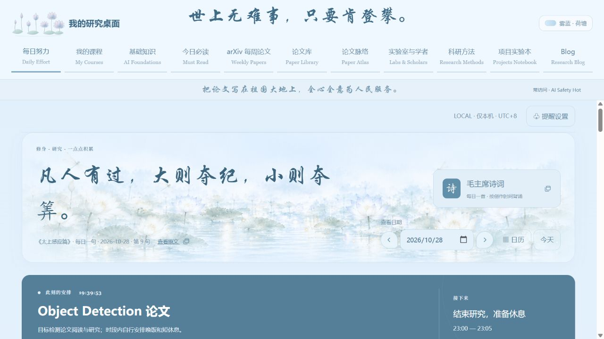

# ResearchStarterKit · 雾蓝 · 荷塘（完整网站）

这份公开副本来自正在使用的科研桌面：**保留原有页面、交互、后端、雾蓝荷塘样式；不携带私人数据库与课程内容**。之前的简化静态模板已经被这份完整源码替换。

[English](README_EN.md) · [完整版源码](sites/mist-blue-lotus/app/) · [运行说明](sites/mist-blue-lotus/README.md) · [发布边界](docs/PUBLIC-RELEASE.md)



## 启动

需要 Python 3.11+，从仓库根目录运行：

```sh
python run.py
```

打开 **http://127.0.0.1:8869/#daily**。页面需要 Python 本地服务，不能只双击 HTML，也不能用 GitHub Pages 运行 Python／SQLite。第一次运行会在公开副本自己的 `app/local-data/` 中创建新的空数据库。

## 保留的功能

- 每日日程、日期选择、模板、待办与每周记录。
- arXiv 观测台、论文天穹、横向时间线和每日／每周归档。
- 论文库、完整论文阅读器、阅读任务、笔记和问题集合。
- 论文脉络、主题／问题／方法分类及问题对比。
- 学者目录、科研方法、项目实验笔记、普通 Blog。
- 基础课程／科研课程／自研课程的管理界面和分类操作，**没有预装个人课程、PPT 或课程笔记**。
- 珍珠小鱼荷塘、折叠、孵化／放生和每日／每周统计。

界面功能保留，但没有你的论文、学者、项目、博客、进度或课程记录；因此新安装页面从空白状态开始。原站仍完整保留。私人 News／Idea 模块按原要求不随公开副本发布。

## 目录

| 目录 | 内容 |
| --- | --- |
| `sites/mist-blue-lotus/app/` | 完整网站后端与所有页面，按原有内部结构保留 |
| `sites/mist-blue-lotus/run.py` | 独立站点启动入口 |
| `tests/` | 网站回归测试 |
| `scripts/` | 发布检查工具 |
| `docs/` | 使用说明、迁移说明、历史文档与空数据预览 |

旧 `toolkit/` 的重复快照已由当前完整源码统一替代；原有 Git 历史未重写。

## 验证与数据隔离

```sh
python scripts/check_full_release.py
python scripts/run_site_checks.py
```

公开副本使用 **8866—8870**，原站使用 **8766—8770**，两者数据路径和浏览器来源分开。数据库、上传文件、课程资料、缓存和日志均被 Git 排除。`python run.py --preview --no-browser` 可用于禁用本次预览自动采集的验收。

arXiv 更新需要网络和运行中的服务；Zotero 需要使用者自行连接。PPT 转换等可选功能保留实现，但仍需对应的 Windows／PowerPoint 等工具。完整功能与限制见运行说明。
