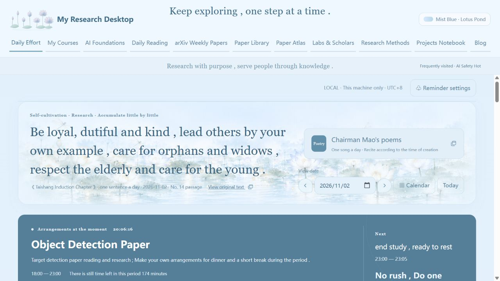

# ResearchStarterKit · Mist Blue & Lotus Pond

**English research workspace · 中英文项目介绍**

An English-interface research desktop for organizing papers, courses, research notes, projects, and daily work. It keeps the mist-blue lotus visual design and runs locally with Python and SQLite.

一个采用雾蓝荷塘风格的本地科研工作台。公开版使用英文界面，帮助管理论文、课程、研究笔记、项目和每日日程；使用 Python 与 SQLite 在本机运行。

[English guide](README_EN.md) · [Full application / 完整源码](sites/mist-blue-lotus/app/) · [Run guide / 运行说明](sites/mist-blue-lotus/README.md) · [Privacy boundaries / 发布边界](docs/PUBLIC-RELEASE.md)



## Start / 启动

Requires **Python 3.11+**. From the repository root:

需要 **Python 3.11 或更新版本**，在仓库根目录运行：

```sh
python run.py
```

Open **http://127.0.0.1:8869/#daily**. To start without opening a browser:

打开以上地址。若不需要自动打开浏览器：

```sh
python run.py --no-browser
```

This is a local Python application, not a static GitHub Pages site. GitHub hosts the source; download it and run it on your own computer.

这是本地 Python 应用，GitHub 用来保存源码。GitHub Pages 不能运行这里的 Python／SQLite 后端，请下载后在本机启动。

## Features / 功能

| Module | 用途 |
| --- | --- |
| Daily Effort | 日程、模板、待办和每周记录 |
| arXiv Observatory | 论文浏览、星图、时间线与归档 |
| Paper Library & Reader | 论文库、原文阅读、阅读任务、笔记与问题 |
| Paper Atlas | 按主题、问题、方法整理研究脉络与论文对比 |
| Courses & AI Foundations | 课程分类与基础知识管理，不含私人课程资料 |
| Labs, Scholars & Methods | 学者、实验室与科研方法 |
| Projects & Blog | 项目实验记录和普通博客 |
| Lotus Pond | 论文阅读相关的小鱼荷塘与统计 |

## Private data stays private / 私人数据不随公开版发布

This repository contains application code and interface assets. It does **not** include the owner's private databases, papers, courses, notes, screenshots, uploaded documents, reading history, daily news, or private News/Ideas modules.

本仓库保留网站源码和界面素材，**不包含作者的私人数据库、论文记录、课程内容、笔记、截图、上传文档、阅读进度、每日新闻及私人 News／Idea 模块**。

New installations create their own empty databases under `sites/mist-blue-lotus/app/local-data/`. Runtime files are ignored by Git. The public edition uses ports **8866–8870** and does not share the private edition's databases.

首次运行会在上述目录创建本副本自己的空数据库；运行数据被 Git 忽略。公开版使用 **8866–8870** 端口，与自用版数据隔离。

## English interface / 英文界面

English UI translations are bundled locally; the running website does not need an online translation service for interface labels. Some specialist wording originates from machine translation and may be refined. User-entered text, original paper titles, and saved notes are not translated or rewritten by the interface layer.

英文界面词表随源码一起提供，运行时不需要在线翻译界面。部分专业表述由机器翻译生成，后续可校订；界面翻译不会改写用户输入、论文原始标题或已保存的笔记。

## Checks / 检查

```sh
python scripts/check_full_release.py
python scripts/run_site_checks.py
```

Optional collectors, Zotero connections, and document converters need their own network access or installed tools. Empty states are intentional: no personal research records are bundled.

可选论文采集、Zotero 连接和文档转换需要相应网络或工具。首次安装为空是正常状态，公开版不预装私人研究记录。

## Structure / 目录

| Path | Purpose / 用途 |
| --- | --- |
| `sites/mist-blue-lotus/app/` | Full application / 完整应用 |
| `run.py` | Local launcher / 本地启动入口 |
| `tests/` | Regression tests / 回归测试 |
| `scripts/` | Release checks / 发布检查 |
| `docs/` | Guides and screenshots / 说明与截图 |

Existing Git history is preserved. Excluding private data from this release is not a claim that past Git history has been purged.

保留现有 Git 历史；本次排除私人数据不代表已经清除过去历史中的内容。
